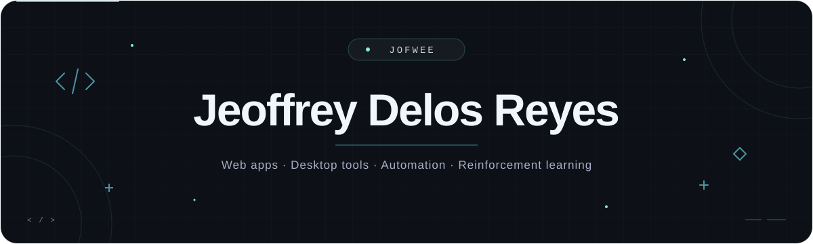

  <a href="https://www.linkedin.com/in/jeoffrey-delos-reyes-666744270/"><strong>LinkedIn</strong></a>
  ·
  <strong>Discord</strong> · <code>jofwee</code>

- **Web** · TypeScript, React, Next.js, HTML/CSS, responsive UI, accessibility
- **Data** · SQL, PostgreSQL, Supabase, SQLite, REST APIs, data pipelines
- **Python** · PySide6/Qt, Tkinter, pywebview, Requests, Beautiful Soup, PyInstaller
- **ML & visualization** · PyTorch, NumPy, deep Q-learning, Pygame, Matplotlib, NLP summarization
- **Workflow** · Git, GitHub Actions, Playwright, automated testing, web scraping

[Baby Face Studios](https://www.babyfacestudios.net/) · [Microsleep Detection](https://github.com/jofwee/Microsleep-Detection-for-Night-Shift-BPO-Agents) · [Courtside](https://courtside-fantasy-basketball.vercel.app/) · [News Automation](https://github.com/jofwee/News-Python-Automation) · [After Hours](https://waneellagallery.vercel.app) · [Others](https://github.com/jofwee?tab=repositories)
